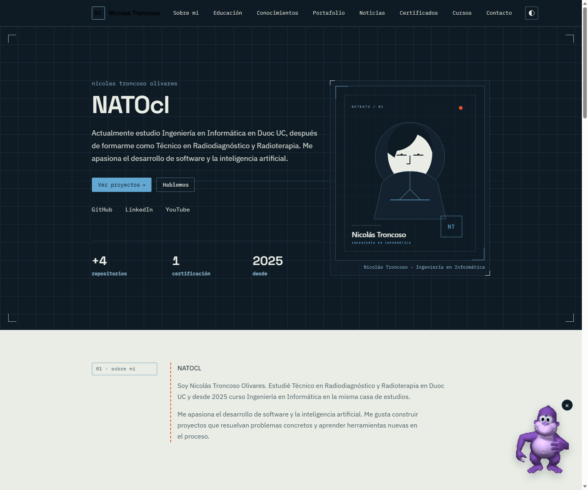
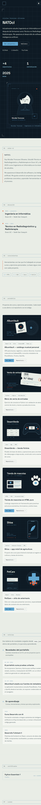
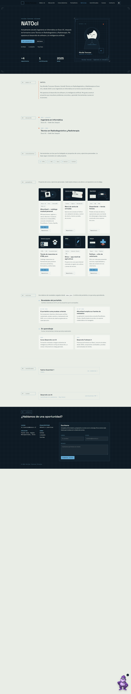

# Nicolas Troncoso — CV + AlbumVault

Portafolio personal de Nicolas Troncoso Olivares, estudiante de Ingeniería en Informática en Duoc UC. Incluye el CV y **AlbumVault**, una aplicación independiente para organizar y valorar un catálogo musical personal.

## Demo

- **CV:** https://nato-cv.onrender.com/
- **AlbumVault:** https://nato-cv.onrender.com/albumvault/
- **Repositorio:** https://github.com/NATOcl/NATO

## Características del portafolio

- **React 19 + Vite 8** con componentes funcionales, props, estado y efectos.
- **Bootstrap 5.3** integrado con la estética propia del sitio:
  - `Navbar` en la cabecera.
  - `Card` y `Grid` en proyectos y noticias.
  - `Button` en los llamados a la acción.
  - `Form` y `FormControl` en el formulario de contacto.
- **Componentes reutilizables con props:** `Section`, `ProjectCard`, `NewsCard`, `NewsSection` y `ContactForm`.
- **Datos desde JSON:** proyectos y noticias se cargan con `fetch` desde `public/data/`.
- **Sección de noticias con dos tableros** cargados dinámicamente desde `news.json`.
- **Estado e interacción:** tema claro/oscuro persistente, menú móvil, modal de PDF, validación del formulario y reintento de carga de datos.
- **Accesibilidad:** etiquetas `alt`, formularios con `label`, foco visible, navegación por teclado, `aria-expanded`, `aria-live` y enlace para saltar al contenido.
- **Rendimiento:** portadas SVG ligeras, `loading="lazy"` y `decoding="async"` en las imágenes de proyectos, JSON asíncrono y build minificado por Vite.
- **Pruebas unitarias con Jasmine + Karma**, con informe de cobertura en HTML.

## Stack

- **CV:** React 19, Vite 8, Bootstrap 5.3, CSS propio y Google Fonts.
- **AlbumVault:** React 18, Vite 8, Bootstrap Reboot e IndexedDB.
- **Servidor:** Node.js; sirve ambas apps y hace de proxy para MusicBrainz, iTunes y Spotify.
- **Tests:** Jasmine, Karma, esbuild e Istanbul.
- **Deploy:** Render, definido en [`render.yaml`](./render.yaml).

## Requisitos

- Node.js `^20.19.0 || >=22.12.0`.
- npm 10 o superior.
- Chrome o Edge para ejecutar Karma en modo headless.

## Instalación y ejecución

```bash
npm install
npm install --prefix AlbumVault
```

Desarrollo completo (CV, AlbumVault y API):

```bash
npm run dev
```

- CV: http://localhost:5173
- AlbumVault: http://localhost:5174/albumvault/
- API: http://localhost:3000

Scripts individuales:

```bash
npm run dev:cv      # solo el CV
npm run dev:app     # solo AlbumVault
npm run dev:api     # solo el servidor raíz
```

Producción local:

```bash
npm run build
npm start
```

El build genera `dist/` y `AlbumVault/dist/`. `npm start` sirve ambos y la API en http://localhost:3000.

## Pruebas y cobertura

```bash
npm test             # ejecución única + informe de cobertura
npm run test:watch   # modo interactivo
```

El informe HTML queda en `coverage/html/index.html`. La última ejecución local obtuvo **22 pruebas exitosas** y una cobertura de **87,8 % de sentencias**, **67,8 % de ramas**, **95,1 % de funciones** y **89,0 % de líneas**.

Karma busca Chrome o Edge automáticamente. Si no lo encuentra, define la ruta:

```bash
# Windows (PowerShell)
$env:CHROME_BIN="C:\Program Files (x86)\Microsoft\Edge\Application\msedge.exe"
npm test
```

```bash
# Linux / macOS
CHROME_BIN=/usr/bin/google-chrome npm test
```

El plan de pruebas, los casos y los resultados esperados están documentados en [`TESTING.md`](./TESTING.md).

## Estructura

```text
index.html                 entrada de Vite
src/App.jsx                orden de las secciones
src/components/            componentes del CV
src/hooks/useJsonData.js   carga de JSON con estado, error y reintento
src/data/content.js        perfil, navegación, educación, skills y contacto
src/css/main.css           estilos propios y ajustes sobre Bootstrap
public/data/               projects.json y news.json
public/assets/projects/    portadas SVG de los proyectos
src/assets/portrait.svg    retrato ilustrado del hero
test/                      specs de Jasmine y utilidades
karma.conf.cjs             configuración de Karma + esbuild + cobertura
TESTING.md                 plan de pruebas
AlbumVault/                SPA musical independiente
server.js                  sirve CV, AlbumVault y API
```

## Editar contenido

- **Proyectos:** `public/data/projects.json`. Cada elemento incluye `title`, `description`, `technologies`, `image`, `imageAlt` y al menos `demo` o `repo`.
- **Noticias:** `public/data/news.json`. Contiene dos secciones; cada noticia tiene `title`, `date`, `dateTime` y `content`.
- **Portadas:** `public/assets/projects/`. Se referencian con rutas relativas (`assets/projects/...`) para que funcionen en la raíz o en un subdirectorio.
- **Retrato:** `src/assets/portrait.svg` es una ilustración vectorial. Para usar una fotografía real, reemplaza el archivo manteniendo una proporción vertical similar (6:7) y actualiza el `alt` si cambia la descripción.
- **Textos y enlaces del CV:** `src/data/content.js`.

## Capturas

Vista de escritorio:



Vista móvil:



Página completa:



## Accesibilidad y rendimiento

- Todas las imágenes tienen texto alternativo; los controles tienen nombre accesible.
- El formulario valida en el navegador, marca `aria-invalid`, describe los errores y enfoca el primer campo inválido.
- El menú móvil informa su estado con `aria-expanded` y `aria-controls`.
- La navegación respeta `scroll-margin-top` y el foco visible.
- Las animaciones se desactivan con `prefers-reduced-motion: reduce`.
- Las imágenes de proyectos usan SVG, dimensiones explícitas y carga diferida.
- Vite minifica CSS y JavaScript; Bootstrap se sirve como CSS minificado.

## Despliegue

`render.yaml` define el servicio Node en Render. El servidor necesita Node porque también sirve AlbumVault y las APIs; una página puramente estática puede mostrar el CV, pero no la app musical ni el proxy de metadatos. GitHub Pages conserva un stub que redirige a la demo publicada en Render.

## Autor

Nicolas Troncoso Olivares — [GitHub](https://github.com/NATOcl) · [LinkedIn](https://www.linkedin.com/in/nicolas-troncoso-olivares-1257143b6/) · ni.troncoso@duocuc.cl
